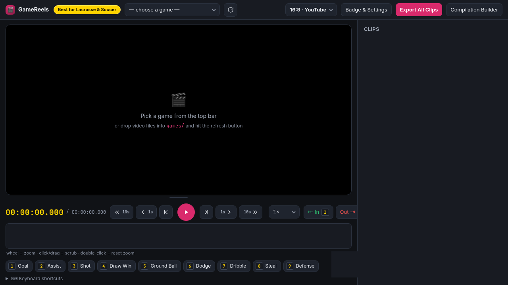

# 🎬 GameReels



Turn full-game Veo film into social clips — Reels, YouTube Shorts, and 16:9. **Best for lacrosse and soccer.**
Keyboard-first clipping, hotkey labels, click-to-track player badge overlays, one-button export and stitching.
See `PLAN.md` for the design.

## Start it

```
npm install        (first time only — also downloads a bundled ffmpeg, nothing to install)
npm start
```

Then open **http://localhost:4242** in your browser (Chrome/Edge). On Windows, `Start GameReels.bat`
does both: it opens the browser and starts the server.

1. Copy game files into the `games/` folder (Veo MP4 downloads work as-is), hit **⟳**.
2. Pick the game from the dropdown.
3. Open **Badge & Settings** once and fill in the player's name, number, and colors. Name and number start blank (`Player` / `#00` are placeholders).

## The workflow

| Step | How |
|---|---|
| Scan the game | `Space` play, `L` cycles 1×/2×/4×/8×/16× (last speed is remembered), `J` back 10s, `Shift+←→` 1s |
| Found a play | `I` at the start, `O` at the end, `C` → clip created & auto-named |
| Fine trim | `←→` step one frame (33 ms); `,`/`.` nudge IN, `Shift+,`/`.` nudge OUT |
| Label it | `1`–`9` (Goal, Assist, Shot, Draw Win, Ground Ball, Dodge, Dribble, … — lacrosse and soccer defaults; edit the list in Settings) |
| Track the player | `T` → click their feet → video auto-advances → click again → `Esc` when done (`U` undoes) |
| Check it | ▶ Review on the clip — overlay preview plays live |
| Pick a format | top-bar selector: **16:9 · YouTube** (1920×1080) or **9:16 · Reels** (1080×1920) |
| Export | `E` (or Export per clip, or **Export All**) → MP4s land in `clips/YouTube/` or `clips/Reels/` by format. Exports queue up and run in the background — keep clipping; progress shows on each clip and in the top bar, and **Cancel** / ✕ stops one |
| Reorder | ▲▼ on a clip (or `Alt+↑↓`) — sets the numbering used in export filenames |
| Compilation | **🎞 Compilation Builder** — all exported clips from every game: check, reorder with ▲▼, stitch |
| Transitions | builder dropdown: hard cut, crossfade, fade through black, slide, circle reveal (0.5 s) |
| Intro/Outro | builder cards: photo + kicker/title/subtitle text on a dark highlight card, 3.5 s each |

## Export formats

- **16:9 (YouTube)** — full Veo frame, 1920×1080. YouTube's recommended landscape spec.
- **9:16 (Instagram Reels)** — 1080×1920 vertical. The crop **auto-follows the tracked player** using
  the tracking anchors (with smooth camera-style panning); untracked clips center-crop.
  The same file works for YouTube Shorts and TikTok. In 9:16 mode a dashed guide on the
  player shows exactly what the crop will keep — **drag the video left/right** to shift the
  crop off the tracked player when the action is beside them (double-click to recenter;
  the shift is saved per clip).
- Exports encode on the **NVIDIA GPU (NVENC)** when there is one — about 1.8× faster than the
  CPU on this PC — and fall back to the CPU (libx264) automatically; the server prints which one
  it picked at startup. `set CC_ENCODER=cpu` before `npm start` forces the CPU.
- Vertical exports get a ` [9x16]` suffix, and exports are sorted into `clips/YouTube/`
  or `clips/Reels/` by format.
- Stitching same-format clips from the same encoder is lossless (GPU and CPU exports have
  different H.264 headers, so mixing them re-encodes); mixing formats re-encodes with padding (the
  builder warns you — usually keep one format per compilation). Picking a transition or
  adding intro/outro cards always re-encodes (that's what blends the frames).
- Intro/outro cards: check the box in the builder, pick a photo, fill in the text
  (use `|` in the title for a line break). The card matches the compilation's shape —
  16:9 gets the left text panel, 9:16 gets the bottom-third layout. Text is remembered;
  re-pick the photo each session.

Everything autosaves per game into `projects/` — close the browser, come back later,
your clips and tracking are still there. The previous save is kept as `.json.bak`, and a damaged
project file is restored from it automatically.

The server only answers on this PC (`127.0.0.1`) and only plays videos from `games/`, so other
devices on your network can't reach it.

## Tracking tips

- **Leave spacing at 15 frames (~0.5 s).** Measured on 39 real clips: the spline through
  15-frame clicks lands within ~3 px (p95 ≈ 10 px) of 5-frame clicks — the badge ring is ~90 px
  wide, so it's visually identical at a third of the clicks. Use **30 frames (~1 s)** on straight
  runs (≈5× fewer clicks, p95 ≈ 15 px); drop to **10** only for dodges and draw scrambles.
  Check your own footage anytime: `node tools/spacing-report.js`.
- Click the player's **feet** — the circle sits there and the name badge hangs just below it.
- If the player is briefly hidden behind someone else, press `→` to skip ahead without clicking.

## Folders

- `games/` — put full-game video files here
- `clips/YouTube/` and `clips/Reels/` — exported clips by format; stitched compilations land in `clips/`
- `projects/` — autosaved work (one JSON per game; safe to back up)

## Health check

`node test-export.js` (with the server running) round-trips a tracked export,
a plain cut, and a stitch against a synthetic test video; `node test-ui.js` drives the real UI
with Playwright. Both write their outputs to `clips/_test/` — hidden from the Compilation
Builder — and delete them when they finish.
